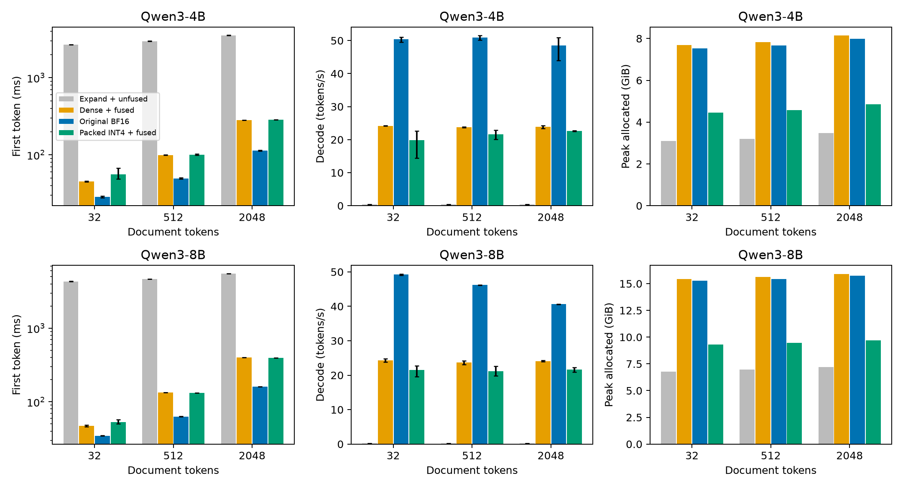
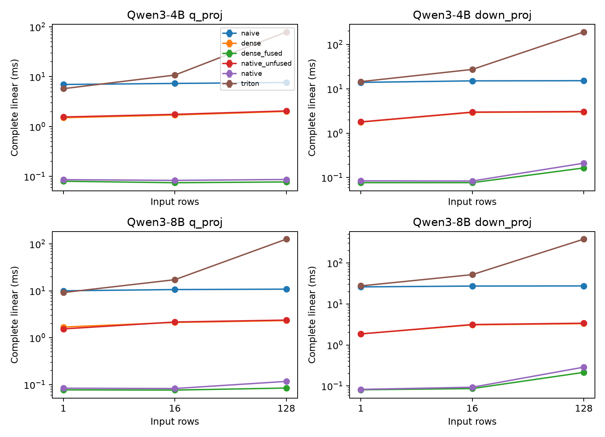

# Published ParoQuant models on Ascend 910B2C

The Ascend implementation runs the published Qwen3-4B-PARO and Qwen3-8B-PARO
checkpoints directly. It combines a fused eight-stage pairwise rotation with
native packed-INT4 matrix multiplication. The original learned rotations,
channel scales, group scales, and zero points remain unchanged. Compared with
cached FP16 execution of those weights, the packed path reduces allocated peak
memory by 38.9–42.1%, with 5.0–18.1% lower decode throughput.

Draft contribution: [ParoQuant #57](https://github.com/z-lab/paroquant/pull/57).

## Performance

The packed implementation uses **38.9–42.1% less peak allocated memory** than
cached FP16 execution of the same quantized weights. Its mean decode throughput
is **45.6–83.6×** that of the naive expand-and-rotate implementation. Against
the dense fused baseline, decode throughput is **5.0–18.1% lower**. The original
BF16 models are faster than either quantized execution path on this host. The
naive path has the smallest steady allocation, trading repeated expansion for
very low throughput. These measurements separate execution of the same PARO
weights from comparison with the original model.

All timings below come from the exclusive performance window: six independent
operator processes and 24 independent model processes. Each model request
generates eight tokens: TTFT includes the first, and decode speed uses the
following seven. The 32/512/2048 document tokens become 54/534/2070 tokens after
chat formatting. Entries show the mean and [minimum, maximum] across three
processes; memory is the largest allocated peak across those processes.

| Model | Document tokens | Path | TTFT (ms) | Decode (tokens/s) | Peak (GiB) |
|---|---:|---|---:|---:|---:|
| 4B | 32 | Expand + unfused | 2683.43 [2669.81, 2692.05] | 0.434 [0.434, 0.434] | 3.090 |
| 4B | 32 | Dense FP16 + fused | 45.20 [44.68, 45.56] | 24.184 [24.150, 24.237] | 7.680 |
| 4B | 32 | Original BF16 | 28.46 [27.86, 29.02] | 50.405 [49.512, 51.062] | 7.526 |
| 4B | 32 | Packed INT4 + fused | 55.83 [48.37, 67.01] | 19.811 [14.461, 22.677] | 4.446 |
| 4B | 512 | Expand + unfused | 2976.90 [2967.75, 2986.79] | 0.434 [0.434, 0.434] | 3.198 |
| 4B | 512 | Dense FP16 + fused | 99.43 [99.17, 99.66] | 23.772 [23.626, 23.919] | 7.829 |
| 4B | 512 | Original BF16 | 49.44 [48.62, 50.19] | 50.953 [50.218, 51.521] | 7.668 |
| 4B | 512 | Packed INT4 + fused | 100.62 [99.53, 102.24] | 21.631 [20.039, 22.875] | 4.566 |
| 4B | 2048 | Expand + unfused | 3554.56 [3542.62, 3565.54] | 0.435 [0.434, 0.435] | 3.482 |
| 4B | 2048 | Dense FP16 + fused | 280.60 [280.49, 280.68] | 23.854 [23.390, 24.292] | 8.142 |
| 4B | 2048 | Original BF16 | 112.85 [111.64, 114.48] | 48.546 [43.924, 50.967] | 7.978 |
| 4B | 2048 | Packed INT4 + fused | 284.61 [283.86, 285.08] | 22.656 [22.450, 22.774] | 4.857 |
| 8B | 32 | Expand + unfused | 4318.50 [4294.28, 4332.44] | 0.259 [0.259, 0.260] | 6.787 |
| 8B | 32 | Dense FP16 + fused | 47.06 [46.22, 48.38] | 24.257 [23.766, 24.759] | 15.444 |
| 8B | 32 | Original BF16 | 34.61 [34.37, 34.80] | 49.233 [48.963, 49.413] | 15.292 |
| 8B | 32 | Packed INT4 + fused | 53.03 [50.03, 57.64] | 21.515 [19.581, 22.726] | 9.292 |
| 8B | 512 | Expand + unfused | 4662.58 [4643.26, 4674.38] | 0.259 [0.259, 0.259] | 6.955 |
| 8B | 512 | Dense FP16 + fused | 133.47 [133.36, 133.53] | 23.703 [23.080, 24.143] | 15.643 |
| 8B | 512 | Original BF16 | 63.17 [62.89, 63.37] | 46.212 [46.137, 46.286] | 15.425 |
| 8B | 512 | Packed INT4 + fused | 132.56 [132.22, 132.91] | 21.115 [19.877, 22.588] | 9.463 |
| 8B | 2048 | Expand + unfused | 5516.80 [5494.53, 5528.27] | 0.259 [0.259, 0.259] | 7.218 |
| 8B | 2048 | Dense FP16 + fused | 401.17 [400.85, 401.58] | 24.059 [23.931, 24.304] | 15.911 |
| 8B | 2048 | Original BF16 | 161.36 [161.13, 161.48] | 40.615 [40.528, 40.692] | 15.760 |
| 8B | 2048 | Packed INT4 + fused | 395.31 [394.72, 395.91] | 21.687 [20.871, 22.247] | 9.714 |

The largest variation occurs in the 4B packed path at the shortest input:
14.46–22.68 tokens/s across the three processes. All observations remain in
the reported mean. At 2048 document tokens, 8B packed TTFT is 395.31 ms against
401.17 ms for the dense fused baseline, while its decode rate remains lower.

### Preparation and cold allocation

Loading includes dense weight expansion where applicable. The initial forward
uses the short warmup prompt and includes lazy rotation/layout preparation.
Cold peak is the larger of loading and initial-forward allocation; larger
controlled prompts can have a higher steady peak. Prompt-specific prefill and
decode warmup is separate and retained in the raw and summary tables.

| Model | Path | Loading (s) | Initial forward (s) | Cold peak (GiB) |
|---|---|---:|---:|---:|
| 4B | Expand + unfused | 2.993 [2.966, 3.006] | 4.849 [4.832, 4.868] | 3.080 |
| 4B | Dense FP16 + fused | 7.008 [6.969, 7.039] | 0.508 [0.472, 0.567] | 8.079 |
| 4B | Original BF16 | 3.536 [3.501, 3.593] | 0.366 [0.348, 0.380] | 7.513 |
| 4B | Packed INT4 + fused | 2.835 [2.813, 2.874] | 2.593 [0.691, 6.384] | 4.436 |
| 8B | Expand + unfused | 3.847 [3.826, 3.867] | 6.444 [6.420, 6.460] | 6.774 |
| 8B | Dense FP16 + fused | 9.390 [9.385, 9.393] | 0.479 [0.472, 0.484] | 16.277 |
| 8B | Original BF16 | 9.038 [4.781, 17.308] | 0.375 [0.372, 0.379] | 15.279 |
| 8B | Packed INT4 + fused | 3.704 [3.693, 3.716] | 1.859 [0.726, 4.119] | 9.232 |

### Operator ablation

Complete linear-layer mean latency in milliseconds includes rotation and
matrix execution. Each of three independent processes measures ten warmed
calls. Rotation fusion reduces native W4A16 linear latency in every tested
shape. The tiled Triton matrix path is slower than the native path in every
tested shape; avoiding full weight expansion alone does not provide competitive
matrix throughput. The dense fused path is the fastest of these six paths in
every tested shape. Per-process ranges, layout preparation, and numerical
errors are retained in [`results/summary/layers.csv`](results/summary/layers.csv).

| Model / layer | Rows | Expand + unfused | Dense + unfused | Dense + fused | Native + unfused | Native + fused | Tiled Triton + fused |
|---|---:|---:|---:|---:|---:|---:|---:|
| 4B / q_proj | 1 | 7.0008 | 1.5057 | 0.0802 | 1.5594 | 0.0862 | 5.7622 |
| 4B / q_proj | 16 | 7.3399 | 1.7096 | 0.0749 | 1.7606 | 0.0834 | 10.8036 |
| 4B / q_proj | 128 | 7.6647 | 2.0188 | 0.0776 | 2.0634 | 0.0869 | 79.0288 |
| 4B / down_proj | 1 | 13.9666 | 1.7776 | 0.0767 | 1.7966 | 0.0842 | 14.5143 |
| 4B / down_proj | 16 | 15.1077 | 2.9415 | 0.0767 | 2.9868 | 0.0835 | 27.3634 |
| 4B / down_proj | 128 | 15.2397 | 3.0195 | 0.1645 | 3.0790 | 0.2107 | 191.0294 |
| 8B / q_proj | 1 | 10.0219 | 1.6910 | 0.0775 | 1.5418 | 0.0841 | 9.1923 |
| 8B / q_proj | 16 | 10.6456 | 2.1221 | 0.0767 | 2.1657 | 0.0827 | 17.2690 |
| 8B / q_proj | 128 | 10.8577 | 2.3247 | 0.0847 | 2.3807 | 0.1174 | 126.3895 |
| 8B / down_proj | 1 | 26.0111 | 1.8586 | 0.0808 | 1.8568 | 0.0825 | 27.4700 |
| 8B / down_proj | 16 | 27.2362 | 3.0876 | 0.0865 | 3.1452 | 0.0931 | 51.7321 |
| 8B / down_proj | 128 | 27.4440 | 3.3054 | 0.2144 | 3.3879 | 0.2874 | 379.0524 |

All 216 measured operator cases pass the independent per-path comparison;
maximum relative L2 error is 0.0010274. Full-model quality is evaluated separately
from these latency measurements.

## Execution

For each input row, a Triton Ascend program loads a complete 128-channel
rotation group. Partner indices and sine/cosine coefficients are prepared
once from the checkpoint. All eight rotation stages execute in the same
program; each stage rounds to FP16 before the next. The activation is written
once after the final stage. Decode uses one row per program; larger inputs
use eight rows per program.

AWQ stores eight unsigned four-bit weights in each INT32 word in the order
`[0, 2, 4, 6, 1, 3, 5, 7]`. The native Ascend operator consumes consecutive
signed nibbles. The conversion reorders the nibbles and flips each sign bit,
representing `q - 8`. Its offset is `8 - z`, so native dequantization computes
`((q - 8) + (8 - z)) * scale = (q - z) * scale`.
The native packed copy and offsets are prepared once. They are nonpersistent
buffers, preserving the published checkpoint serialization format.

An additional Triton path unpacks only the weight tile used by a matrix tile.
It selects a vector reduction for at most four input rows and a Cube matrix
operation for larger inputs. The operator comparison includes this path along
with the native packed implementation.

The native eager path uses ND packed weights and high-precision computation.
The installed `npu_weight_quant_batchmatmul` documentation restricts packed
INT4 FRACTAL_NZ execution to graph mode and requires a transposed activation
for its group-128 configuration.

## Numerical validation

Independent CPU references cover pairwise rotation and explicit INT4
dequantization for input row counts 1, 3, 17, and 64, including unaligned row
counts. Both the tiled Triton and native matrix implementations pass the
numerical checks. Full models additionally compare every quantized linear
layer against the same checkpoint expanded to FP16 with materialized rotation
stages.
The independent operator results are recorded in
[`research/numerical_validation.json`](research/numerical_validation.json).

| Published checkpoint | Compared layers | Largest relative L2 error | Largest absolute error | WikiText-2 perplexity |
|---|---:|---:|---:|---:|
| Qwen3-4B-PARO | 252 | 0.001092 | 1.0 | 13.858716 |
| Qwen3-8B-PARO | 252 | 0.002660 | 8.0 | 9.881995 |

Perplexity uses all 299,077 next-token targets in WikiText-2's raw test split,
with contexts of at most 2048 tokens. Adjacent input chunks share their
boundary token so each target is counted once. The layer errors compare
actual checkpoint activations; the model-level quality metric evaluates
the full test corpus.

## Comparisons

The layer experiment uses the published attention query and MLP down
projections, with 1, 16, and 128 input rows. Six paths isolate rotation fusion,
weight expansion, and the matrix implementation:

| Path | Rotation | Weight execution |
|---|---|---|
| Naive | Materialized stages, cached constant coefficients | Expand INT4 each call, FP16 matrix multiplication |
| Dense | Materialized stages, cached constant coefficients | Cached expanded FP16 weights |
| Dense fused | Fused Triton | Cached expanded FP16 weights |
| Native unfused | Materialized stages, cached constant coefficients | Native packed W4A16 |
| Native | Fused Triton | Native packed W4A16 |
| Tiled Triton | Fused Triton | Tilewise INT4 unpacking and matrix multiplication |

Full-model timing compares naive, dense fused, native, and the original BF16
model. Public WikiText documents provide 32, 512, and 2048 source tokens;
chat formatting contributes to the reported prompt length. Each run produces
eight tokens regardless of EOS. First-token timing includes prefill and token
selection; decode timing covers the next seven tokens. Layer measurements
record weight preparation explicitly. Full-model loading, first-forward time
(including lazy rotation and weight-layout preparation), and prompt-specific
prefill/decode warmup are recorded separately. Cold peak allocation includes
weight preparation. The native path retains checkpoint tensors and its cached
packed representation. The dense full-model baseline releases packed weights,
zero points, and scales after expansion; steady allocation includes the expanded
FP16 weights and only the rotation representation used during execution.

Each timing configuration runs in three independent processes in an exclusive
measurement window. Each layer process times ten calls and stores their
mean; the report gives the range across independent processes. The generation
comparison computes only the final-position vocabulary logits, matching the
model's normal generation path.

Quality evaluation compares native packed execution, dense fused execution of
the same quantized weights, and the original BF16 checkpoint. GSM8K uses all
1319 test questions, greedy generation, batches of eight, non-thinking chat
format, and at most 512 generated tokens. The prompt requests a numerical
answer after `####`; evaluation extracts the final number and normalizes it
with decimal arithmetic. Dataset revisions are recorded in
[`data/sources.json`](data/sources.json).

## Model quality

All six configurations evaluate the same full WikiText-2 raw test sequence
(299,077 next-token targets) and all 1319 GSM8K test questions. GSM8K uses
greedy non-thinking decoding, batches of eight, and at most 512 new tokens.
Each row reports the complete result; concurrent quality-job timings are not
used as performance evidence.

| Model | Execution | WikiText-2 perplexity | GSM8K correct / 1319 | GSM8K accuracy |
|---|---|---:|---:|---:|
| 4B | Packed INT4 + fused | 13.858716 | 1181 | 89.54% |
| 4B | Dense FP16 + fused | 13.859074 | 1185 | 89.84% |
| 4B | Original BF16 | 13.665473 | 1194 | 90.52% |
| 8B | Packed INT4 + fused | 9.881995 | 1149 | 87.11% |
| 8B | Dense FP16 + fused | 9.882060 | 1147 | 86.96% |
| 8B | Original BF16 | 9.728429 | 1152 | 87.34% |

Native and dense execution use identical learned PARO weights and rotations.
Their perplexities differ by less than 0.00036. The original BF16 checkpoints
have lower perplexity. GSM8K results use the stated 512-token non-thinking
protocol; the table separates execution effects from checkpoint quantization.

## Reproduction

[`ASCEND.md`](ASCEND.md) provides the environment, model loading example,
correctness command, and complete timing/quality scripts. Raw results are
stored in `results/`; `experiments/summarize_ascend.py` produces CSV/JSON
tables, and `experiments/plot_ascend.py` produces standalone PDF/PNG figures.
[`research/model_sources.json`](research/model_sources.json) records the
downloaded public checkpoint files and their revisions; actual package
versions are recorded in [`environment_ascend.json`](environment_ascend.json).
Quality runs save progress after every batch or token segment and resume
using the same explicit configuration.

## Limitations

The supported checkpoints use FP16 activations, four-bit weights, and groups
of 128 channels. The results concern one Ascend 910B2C host with the software
versions in `ASCEND.md`. Different numerical reduction orders produce the
measured deviations from explicit FP16 dequantization. The native packed
representation occupies an additional copy of the quantized weights.
GSM8K accuracy uses the stated non-thinking prompt and generation limit.

## References

- [ParoQuant project](https://z-lab.ai/projects/paroquant/).
- [ParoQuant paper](https://arxiv.org/abs/2511.10645).
- [Public implementation and checkpoint links](https://github.com/z-lab/paroquant).
- [Ascend native W4A16 operator](https://github.com/Ascend/op-plugin/blob/master/docs/zh/custom_APIs/torch_npu/torch_npu-npu_weight_quant_batchmatmul.md).
